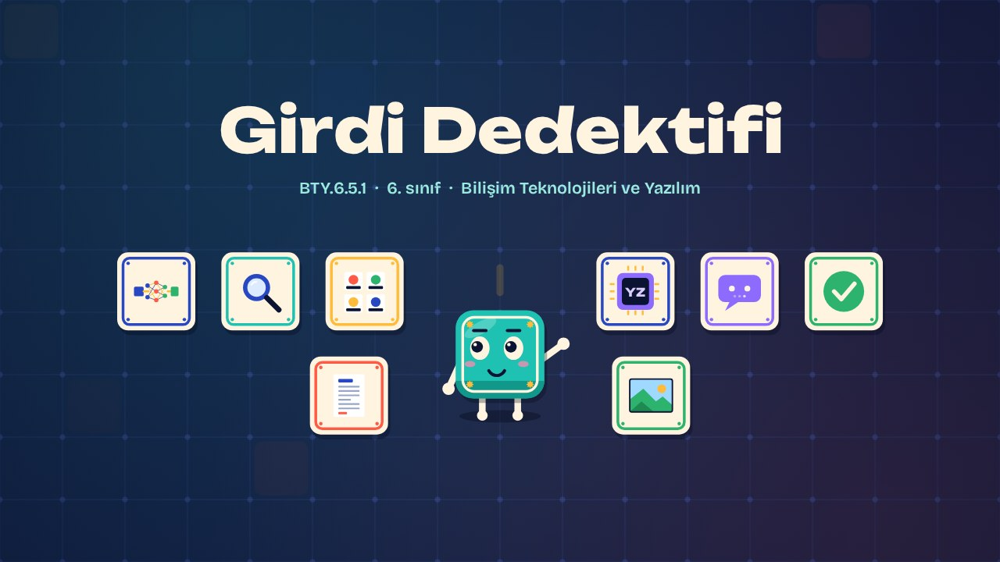
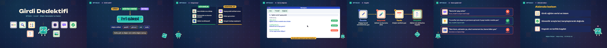

# Girdi Dedektifi · Input Detective

**▶ Tarayıcıda izleyin / Watch in the browser:** https://hakanatas.github.io/girdi-dedektifi/ 
**⬇ MP4 + altyazılar / MP4 + subtitles:** [Releases](https://github.com/hakanatas/girdi-dedektifi/releases) 
**✎ Kullanılan istem / The prompt behind it:** [PROMPT.md](PROMPT.md) 
**🎞 Bütün filmler / All films:** [Bilişim Filmleri](https://hakanatas.github.io/bilisim-filmleri/?sinif=6)

> **TR —** 6. sınıf Bilişim Teknolojileri ve Yazılım dersinin "Yapay Zekâ" temasındaki BTY.6.5.1 öğrenme çıktısı için hazırlanmış, tamamen JavaScript ile çizilen 2,4 dakikalık animasyon; ses efektleri ve hafif fon müziği de kodla üretilir. Yapay zekânın girdileri tanıtılır: modeli eğiten veriler ve kullanıcının yazdığı istemler; daha çok ve doğru etiketlenmiş verinin daha doğru sonuç verdiği örnekle açıklanır. İyi girdinin özellikleri (doğru etiket, çeşitlilik, güncellik, net ve sade ifade) sıralanır. Bilgiye ulaşmak için güvenilir ve kontrol gerektiren araçlar ayrılır; bir arama yapılarak bulunan bilgiler farklı kaynaklarla doğrulanır. Bilgiler kaynak ve tarihle birlikte dijital not defterine kaydedilir; son olarak zayıf ve güçlü istemler karşılaştırılır. Altyazılar Türkçe, İngilizce ya da ikisi birlikte seçilebilir.

A 2.4-minute animation, with code-generated sound, for **6th-grade IT and Software** (Türkiye Yüzyılı Maarif Modeli). AI inputs (training data and prompts) are introduced, with more and better-labelled data giving better results; features of good input are listed; reliable and check-first research tools are sorted; information is found and cross-checked; notes are saved with sources and dates; and weak and strong prompts are compared. The guide is **Karo**, a living glazed tile who never speaks: he tells the story with his face, his arms and the blinking cursor above his head.

## Öğrenme çıktısı · Learning outcome

MEB, Türkiye Yüzyılı Maarif Modeli, Bilişim Teknolojileri ve Yazılım Dersi Öğretim Programı, 6. sınıf, 5. tema "Yapay Zekâ":

**BTY.6.5.1. Yapay zekâ girdileri hakkında bilgi toplayabilme**
- a) Yapay zekâ girdileriyle ilgili gerekli bilgilere ulaşmak için kullanacağı araçları belirler.
- b) Belirlediği araçları kullanarak yapay zekâ girdileri hakkındaki bilgileri bulur.
- c) Yapay zekâ girdileri hakkındaki ulaşılan bilgileri doğrular.
- ç) Yapay zekâ girdileri hakkındaki ulaşılan bilgileri kaydeder.

## Sahneler · Scenes

| # | Zaman | Sahne | Ne oluyor | Çıktı |
|---|---|---|---|---|
| 1 | 0:00–0:16 | Giriş |  |  |
| 2 | 0:16–0:46 | Girdi nedir? | Eğitim verisi ve istem; iyi girdinin özellikleri. | b |
| 3 | 0:46–1:10 | Hangi araç? | Bilgiye ulaşmak için kullanılacak araçlar. | a |
| 4 | 1:10–1:33 | Bul ve doğrula | Bilgiyi bulmak ve farklı kaynaklarla doğrulamak. | b, c |
| 5 | 1:33–1:50 | Kaydet | Bilgiyi kaynak ve tarihle kaydetmek. | ç |
| 6 | 1:50–2:12 | İstem güçlü mü? | Zayıf ve güçlü istemler karşılaştırılır. | b, c |
| 7 | 2:12–2:27 | Aklında kalsın |  |  |

## Çalıştırma · Running it

- **Önizleme:** `index.html` dosyasına çift tıklayın (çevrim dışı da çalışır). Klavye: boşluk oynat/duraklat, ← → 3 sn, Home başa. Adrese `?altyazi=en`, `?bicim=vertical` ya da `?ses=0` eklenebilir.
- **MP4:** bir kez `npm install`, sonra `npm run export -- --format=both --captions=tr` (720p yatay ve dikey, sesli). Google Chrome yüklüyse Playwright onu kullanır (`channel: 'chrome'`); ffmpeg gerekir.
- **Altyazı ve seslendirme notları:** `npm run srt` → `out/girdi-dedektifi_tr.srt`, `_en.srt`, `_tr-en.srt`, `_seslendirme-notlari.txt`.
- **Sürüm dosyaları:** `npm run release` → `release/` klasöründe v1.0'ın 6 dosyası.
- **Yazı kontrolü:** `npm run check` yatay ve dikey düzende, üç altyazı seçeneğiyle üst üste binen, kenardan taşan ya da 720p'de 17 pikselden küçük kalan yazı arar.
- **Düzenleme:** senaryo (sahneler, altyazılar, seslendirme notları) `scenes/film.js` içindedir; değiştirince `npm run build` süreleri, `captions.js` ve `film.config.js` dosyalarını yeniden üretir. Sahne şablonları `src/kit/`, Karo `src/draw/karo.js`, ses `src/audio/synth.js`.

Her kare `renderFrame(t)` ile zamanın saf fonksiyonu olarak çizilir; rastgelelik tohumludur, MP4 ekran kaydı değil kare kare üretimdir. Ses de dosyadan çalınmaz: aynı olay listesinden hesaplanır. Yazı tipleri: Unbounded ve Bricolage Grotesque (SIL OFL 1.1), dosyaya gömülü.

## Lisans · License

**TR —** Bu film ve kodu [Creative Commons Atıf-GayriTicari 4.0 Uluslararası (CC BY-NC 4.0)](https://creativecommons.org/licenses/by-nc/4.0/deed.tr) lisansıyla paylaşılır. Ticari olmayan her amaçla (derste, okulda, eğitim materyalinde) kopyalayabilir, paylaşabilir ve değiştirebilirsiniz; ancak **kaynak göstermek zorunludur**: eser sahibinin adı ve bu deponun bağlantısı belirtilmeden kullanılamaz. Ticari kullanım (satış, ücretli ürün ya da yayın) için izin alınmalıdır.

**EN —** This film and its code are licensed under [Creative Commons Attribution-NonCommercial 4.0 International (CC BY-NC 4.0)](https://creativecommons.org/licenses/by-nc/4.0/). You may copy, share and adapt them for non-commercial purposes, but **attribution is required**: they may not be used without crediting the author and linking to this repository. Commercial use requires permission.

Atıf örneği / Required credit: *“Girdi Dedektifi”, Hakan Ataş, Bilişim Filmleri — https://github.com/hakanatas/girdi-dedektifi — CC BY-NC 4.0*
